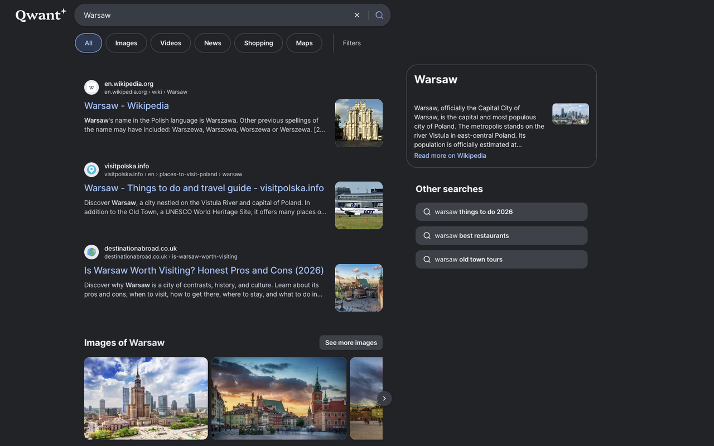

# Maps Tab for Qwant

A small Chrome extension that adds a **Maps** tab to [Qwant](https://www.qwant.com) search results, next to All / Images / Videos. Clicking it opens your current search in the map service you choose.

## Features
- **Maps** tab that always sits at the end of Qwant's tab bar and matches Qwant's styling
- Map services: Google Maps, OpenStreetMap, Bing Maps, Apple Maps, Mapy.com, DuckDuckGo Maps
- Custom tab label, so you can name it in your own language
- Open in the same tab or a new tab
- No data collection, no analytics, no remote code

## Install from source
1. Clone this repo.
2. Open `chrome://extensions` and turn on **Developer mode**.
3. Click **Load unpacked** and select the `extension/` folder.

Click the extension's toolbar icon to change the settings.

## Support
Found a bug or Qwant changed its layout? [Open an issue](https://github.com/ZoltePudeleczko/maps-for-qwant-extension/issues).

## License
[GPL-3.0](LICENSE) © Szymon Zborowski

*This is an independent project and is not affiliated with or endorsed by Qwant.*
